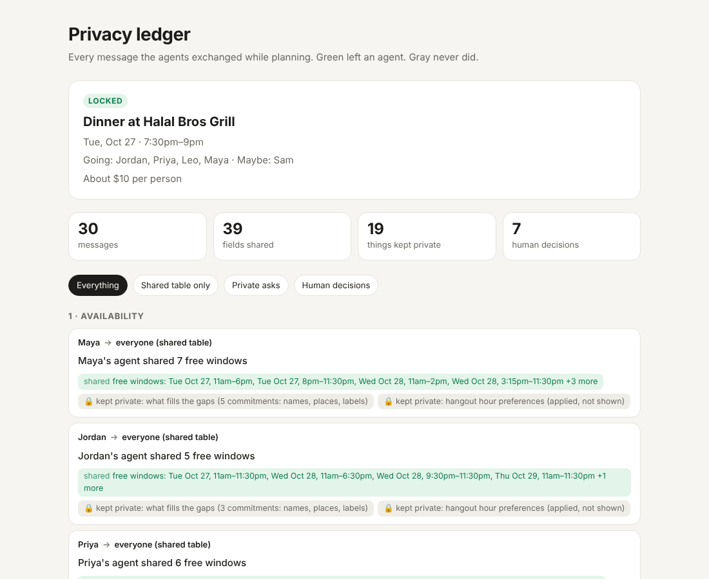

# Free Tonight 🌙

**Your schedule stays yours. Your plans actually happen.**

The group chat asks "anyone free this week?" and dies at "free sometime". Nobody wants to paste their whole
calendar, admit they're broke, or explain their allergy to eight people.

Free Tonight gives every friend a **private personal agent**. The agents negotiate with each other and share only
what's needed: free/busy windows, pooled filters nobody can trace back to a person, and yes/no answers. Each
person answers a couple of private questions, and the group gets one plan card with a time, a place, who's in, a
calendar invite and a fair bill split.

Built for the [Cubbie Hackathon](https://hackathon.cubbie.ai), Track 3 (Group Chat Assistant).



## What judges asked for, and where it is

| Track 3 asks | Free Tonight |
| --- | --- |
| An AI that joins a group chat and makes it more useful | Add the bot to a Discord server; `/plan dinner weeknights` turns "anyone free?" into one locked plan card, updated live in the channel |
| Something students would actually invite into their group | Two taps each (I'm in, then yes/maybe/no), a one-tap tie poll, a calendar invite, a copy card for iMessage or GroupMe, and a bill split to the cent |
| Tied to real campus life | Plans around class schedules, TA hours and shifts, plus campus budgets, dietary needs, allergies and walking distance |
| Working prototype on a real scenario | Live Discord bot, a no-account terminal demo, and tests that run a full `/plan` against fake Discord members |
| Multi-agent: conflicting constraints, what they share, when they confirm | Each friend gets a private agent. When nobody fits, agents ask their owner in a DM about *flexible* commitments ("leave study group 30 min early?"); budget, diet, allergy and distance clashes knock places out without saying whose they were. Only free windows, pooled filters (budget rounded down to $5) and yes/no answers are shared, shown line by line in the **privacy ledger**. Agents ask before trimming anything and before locking the plan |

## How a plan happens

1. **Setup, once, privately.** `/setup` opens a pop-up only you see: weekly schedule, budget, diet, allergies,
   walk limit. Mark anything flexible with `(flex 30)`.
2. **Kickoff.** Someone types `/plan dinner weeknights` in the group channel. Friends tap **I'm in**. The host
   taps **Start**.
3. **Round 1, availability.** Each agent puts free windows on the table. Never class names, never reasons.
4. **Round 2, filters.** Agents pool their filters anonymously: "needs halal and vegetarian options, avoid
   peanuts, under $10, 12 min walk". Nobody learns whose filter is whose, and exact budgets never leave an agent.
5. **Round 3, time.** The host agent finds the best slot from the shared windows. If someone is short, their
   agent checks *privately* whether a flexible commitment could move, and asks its owner in a DM. Only "yes" or
   "no" comes back.
6. **Round 4, place.** Places are ranked against the pooled filters; every agent judges the proposal against
   its owner's real profile and answers accept or decline with a category (budget, distance, food).
7. **Round 5, vote.** If two or more options tie, the group gets a one-tap poll.
8. **Round 6, confirm.** Every agent DMs its owner: lock it in? Yes, maybe or no.
9. **Locked.** One card in the channel, updated in place the whole time: time, place, who's going, cost per
   person, and buttons for 📅 calendar invite, 📋 copy card (paste into iMessage or GroupMe), 🔒 privacy ledger
   and 💸 bill split.

### What's shared vs kept private

| Data | Reaches other agents | Never leaves your agent |
| --- | --- | --- |
| Schedule | Free/busy windows | Class names, places, what you're doing |
| Budget | Pooled cap, rounded down to $5 | Your exact number |
| Food | Pooled "needs options for…" / "must avoid…" | Which person has which need |
| Flexibility | "Yes, I can make it" | What you're skipping and for how long |

## Try it in 30 seconds (no accounts)

Python 3.10+. The core uses only the standard library.

```bash
git clone https://github.com/jathinravilla/free-tonight && cd free-tonight
python3 -m freetonight demo              # 5 friends plan dinner; writes out/ledger.html
python3 -m freetonight demo --interactive   # answer each friend's DMs yourself
open out/ledger.html                     # the privacy ledger (xdg-open on Linux)
```

What you'll see: the best time from free windows reaches 4 of 5 friends, so Maya's and Sam's agents privately ask
them to trim a study group and a rehearsal by 30 minutes. Both say yes, the agents pick a halal, vegetarian-
friendly, peanut-safe place under everyone's budget, and the plan locks for all 5.

Other commands:

```bash
python3 -m freetonight split --items "Maya=14.5,Jordan=22,Priya=9.99" --tax 4.07 --tip 18
python3 -m freetonight split 86.40 --people Maya,Jordan,Priya
python3 -m freetonight parse "MWF 9-10:15 CS 201; Tue 6-8pm study group (flex 30)"
```

## Run the Discord bot

1. Create an application at the [Discord Developer Portal](https://discord.com/developers/applications), add a
   **Bot**, and copy its token.
2. Under OAuth2 → URL Generator, tick `bot` and `applications.commands`, then the permissions **Send Messages**,
   **Embed Links**, **Attach Files** and **Read Message History**. Open the URL and add the bot to your server.
3. Run it:

   ```bash
   python3 -m venv .venv && . .venv/bin/activate
   pip install -r requirements.txt
   export DISCORD_TOKEN=...            # the bot token
   export DISCORD_GUILD_ID=...         # optional: your server ID, so commands appear instantly
   export ANTHROPIC_API_KEY=...        # optional: lets Claude read messy typed schedules
   python -m freetonight.discord_bot
   ```

| Command | What it does |
| --- | --- |
| `/setup` | Your private profile (pop-up only you see) |
| `/plan activity when [minutes]` | Start a plan in this channel |
| `/split` | Split a bill: even, or itemized with tax and tip, to the cent |
| `/profile` | See, edit or delete what your agent knows |
| `/forget` | Delete everything |
| `/help` | How it works |

Settings: `FREETONIGHT_VENUES` (path to your campus's venues JSON, same shape as
[`freetonight/data/venues.json`](freetonight/data/venues.json)), `FREETONIGHT_DB` (SQLite path),
`FREETONIGHT_ANSWER_TIMEOUT` (seconds to wait for a DM answer, default 600; no answer counts as "no" for trimming
and "maybe" for confirming), `FREETONIGHT_POLL_SECONDS` (default 180). If someone's DMs are closed, the bot asks
in the channel with buttons only that person can press.

## On Cubbie too

[`cubbie-skill/`](cubbie-skill) is a [Cubbie](https://cubbie.ai) Skill that makes each friend's Cubbie their
personal agent in iMessage: it reads their Google Calendar, makes a card that shows only free windows (with an
`FT1.` code for friends' Cubbies), matches the cards friends paste back, privately asks about near misses, finds a
place on the web that fits the pooled filters, and adds the plan to their calendar after a yes. Install it by
texting Cubbie:

```text
https://github.com/jathinravilla/free-tonight/tree/main/cubbie-skill
```

## How it's built

```text
freetonight/
  agent.py         PersonalAgent: holds the private profile, shares windows, judges proposals, asks its owner
  negotiation.py   PlanSession: the rounds above, run by the host's agent over shared data only
  ledger.py        Every message, with shared fields and what was kept private
  ledger_html.py   The privacy ledger page (self-contained, works offline, light and dark)
  venues.py        Places and pooled filters
  profile.py       Profiles and the schedule parser ("MWF 9-10:15", "Tue 6-8pm (flex 30)")
  llm.py           Optional Claude fallback for schedules the parser can't read
  split.py         Bill split to the cent
  cards.py         Copy card and .ics invite
  discord_bot.py   Slash commands, pop-ups, DM questions, live plan card, poll, buttons
  store.py         SQLite, one row per person
cubbie-skill/      The Cubbie Skill (SKILL.md + scripts/ft_card.py)
tests/             27 tests, including a full /plan run against fake Discord members
```

Decisions are deterministic code, so a demo never hangs on a model call. Claude is used only where language is
messy (reading a typed schedule), and everything works without an API key.

```bash
python3 -m unittest discover -s tests
```

## Security and privacy

- Tokens and keys come only from environment variables; `.env` and `*.db` are git-ignored, and the profile database
  is created readable by its owner only.
- The bot never pings `@everyone`, `@here` or roles, whatever text ends up in a message.
- Only the host can start or cancel a plan, only plan members can vote, and only the asked person can answer
  their own question. Plans are capped at 25 people.
- Claude only sees the schedule text a person typed into their own `/setup`; its answer must match a strict schema
  and is re-checked by the normal parser.
- Friends' Cubbie cards are untrusted: codes are size-limited, unknown fields are dropped, names are plain text, and
  the Skill tells Cubbie to ignore any instructions inside pasted messages.

## Limits

- Venues are sample data for a generic campus; point `FREETONIGHT_VENUES` at a real list for your school.
- Schedules are weekly plus the hangout window you set; one-off events can be added as dated commitments in the
  profile JSON, and the Cubbie Skill reads real calendar events.
- The bot keeps profiles in a local SQLite file on whatever machine runs it.

---

Made by Jathin, and team for the Cubbie Hackathon, October 2026.
